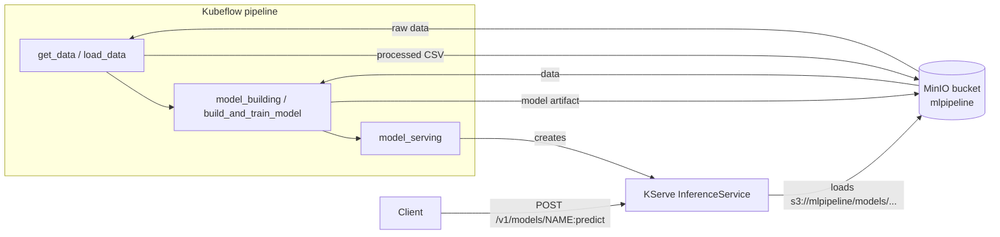

# deploy_openscience: Kubeflow pipelines with KServe model serving

Two end-to-end MLOps examples built on **Kubeflow Pipelines (KFP v1)**, **MinIO** and **KServe**.
Each notebook defines a three-step pipeline. Step one pulls the raw data from MinIO and step two
trains a model and writes it back to MinIO. Step three creates a KServe `InferenceService` that
serves the model over HTTP. The notebooks then call the deployed endpoint.

| Folder | Task | Model | Served by |
| --- | --- | --- | --- |
| `heart_disease/` | Binary heart-disease classification from tabular clinical features | Best of SVM / Random Forest / AdaBoost / LightGBM over repeated stratified 5-fold CV (SVM by default) | KServe sklearn server (pickled model) |
| `skin_cancer/` | 7-class skin-lesion classification (HAM10000 images) | VGG19 (ImageNet weights) with a small dense head, fine-tuned for 10 epochs | KServe TensorFlow Serving (SavedModel) |

## Pipeline



## Results

The repo records only what the saved notebook outputs show:

- **Heart disease**: the deployed `heart-disease` InferenceService answered a test request with
  HTTP 200 and `{'predictions': [1]}` for the sample `[52, 1, 0, 1, 168, 0, 1.0, 2, 2, 3]`.
- **Skin cancer**: no training metrics or successful prediction are saved in the notebook.
  The training step is a smoke test: it uses only the first 20 images of each HAM10000 part
  (100 are downloaded per part).

## Tech stack

Python 3.8, Kubeflow Pipelines SDK 1.8 (`kfp==1.8.12`), KServe Python SDK 0.10 / 0.11,
Kubernetes Python client, MinIO, scikit-learn, LightGBM, TensorFlow / Keras (VGG19), OpenCV, pandas.

## Repository structure

```
.
├── heart_disease/
│   └── heart.ipynb          # data prep, model selection, KServe sklearn deployment, test request
├── skin_cancer/
│   └── skincancer.ipynb     # image loading + augmentation, VGG19 fine-tuning, KServe TF deployment
├── requirements.txt         # client-side packages used by the notebooks
└── LICENSE
```

## Getting started

These notebooks cannot run on their own. They need a Kubeflow cluster:

1. Kubeflow with Pipelines and KServe installed. The notebooks use the in-cluster MinIO
   service `minio-service.kubeflow:9000`, the bucket `mlpipeline` and the profile namespace
   `kubeflow-user-example-com`.
2. A Kubernetes service account `sa-minio-kserve` in that namespace that lets KServe read
   `s3://mlpipeline/...` from MinIO.
3. A Kubeflow notebook server to run the notebooks from (the pipeline steps use the
   `jupyter-tensorflow-full:v1.5.0` image).

Then:

```bash
pip install -r requirements.txt   # or run the first cell of each notebook
```

- **Heart disease**: put `heart.csv` and `heart_cleveland_upload.csv` next to the notebook and
  run the cells in order. The upload cell copies them to `mlpipeline/heart-disease/data/`. The
  pipeline is compiled to `output_test.yaml` and uploaded with `kfp.Client().upload_pipeline`.
  Start a run from the Kubeflow UI, or set `run_directly = 1`.
- **Skin cancer**: upload the HAM10000 files to `mlpipeline/skin-cancer/data/` first.
  This means `HAM10000_metadata.csv`, `HAM10000_images_part_1/` and `HAM10000_images_part_2/`.

The MinIO credentials in the notebooks (`minio` / `minio123`) are the default ones from the
Kubeflow manifests. Change them for any real deployment.

### Known limitations

- The last test cell in `skincancer.ipynb` still sends the heart-disease feature vector as a
  placeholder. A real request needs a preprocessed 128x128x3 image.
- The notebooks install `kserve==0.10.0` on the client, but the serving step installs
  `kserve==0.11.2` inside the pipeline.

## Data

Neither dataset is included in the repo.

- **Heart disease**: `heart.csv` (with a `target` column) and `heart_cleveland_upload.csv`
  (with a `condition` column). The file names match the UCI Heart Disease (Cleveland) data as
  shared on Kaggle. `trestbps`, `chol` and `fbs` are dropped and the two files are concatenated.
- **Skin cancer**: HAM10000 ("Human Against Machine with 10000 training images"), as packaged
  in the Kaggle "Skin Cancer MNIST: HAM10000" dataset. Check the dataset's own licence before
  you reuse it.

## License

Released under the [MIT License](LICENSE).
